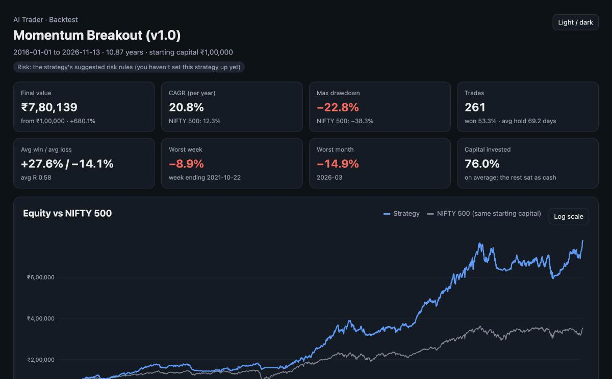

# AI Trader: an AI trading system for Claude Code

A Claude Code plugin that runs a trading system end to end through your broker:
- **any strategy:** ready-made ones, or your own described in plain words;
- **risk rules you choose** for each strategy;
- **backtests** of any strategy on 10+ years of NSE data, with a full report;
- order placement with broker-side stop-losses;
- a journal, weekly reviews and a self-improvement loop.

Once a day you type one command and log in to your broker. Every change the system wants to make to itself waits for your approval.

**Today:** 2 ready-made strategies plus your own, on NSE stocks. **Any broker:** Zerodha and Dhan are ready-made; FYERS, Groww and Upstox are connected for you through their official MCPs; any other broker works in Manual mode.

> **Disclaimer.** This is an experiment shared for education. It is **not investment advice**, and I am not a SEBI-registered adviser. Trading involves risk, including the loss of your capital. Past or backtested results don't guarantee future results. You are responsible for every order placed in your account.

## What it does
| Every trading day (`/trading-day`) | |
|---|---|
| Scan | Your active strategy's rules on official NSE end-of-day data (free, no API key) |
| Judgment | Claude can **veto** a signal (results due, bad news, upper circuit, data mismatch), never add one |
| Risk | The risk rules **you** chose for this strategy: risk per trade, max positions, weekly loss limit, drawdown halt, market filter, broker stop |
| Orders | LIMIT CNC buys through your broker's MCP, protected by **stop / target orders at the broker** (GTT/OCO where the broker has them), or listed for you to place (Manual mode) |
| Exits | The strategy's stop, target, trailing stop, exit rules or time exit |
| Journal | Every trade in detail, from signal to exit: why it was bought, plan vs fill, itemized charges, ₹ at risk, broker stop, best/worst price while open, net P&L and R. Plus every order and stop change with its time, every skipped signal with its numbers, and daily equity |
| Learning | Records every near-miss and its outcome. Suggests lessons and tweaks, which apply only if you approve |

## Brokers
The setup asks which broker you use. You never search for an MCP or edit JSON: the Zerodha, Dhan and FYERS MCPs come with the plugin (you just sign in through `/mcp`), Groww is added once as a claude.ai connector, and for other brokers the bot adds the official MCP for you. Zerodha and Dhan have ready-made profiles; for the others the bot matches the MCP's tools. Then it tests them read-only, asks your brokerage and DP charge, and shows a review screen.

| Broker | How | Orders | Stop-loss at the broker | Notes |
|---|---|---|---|---|
| **Zerodha** | Kite MCP, comes with the plugin | ✅ | two-leg GTT (stop + target) | ready-made, tested live; one login click a day |
| **Dhan** | official MCP (`mcp.dhan.co`), comes with the plugin | ✅ | day stop-loss order | ready-made, not tested with real orders yet; live quotes need Dhan's Data API plan (without it the bot uses NSE closing prices); sells need DDPI |
| **FYERS** | official MCP (`mcp.fyers.in`), comes with the plugin | ✅ | GTT / OCO | |
| **Groww** | official MCP (`mcp.groww.in`), added as a claude.ai connector | ✅ | checked at connect | sells need DDPI |
| **Upstox** | official MCP (`mcp.upstox.com`), added for you | read-only | you place it | Manual mode with live data from the MCP |
| **Any other broker** | no MCP needed | you place them | you place it | Manual mode |

Only Zerodha has been tested with real orders by me so far. A newly connected broker starts in PAPER mode, and its first real order is shown to you before it's placed.

**How stop-losses are kept**, best first. The bot uses the best one your broker has:
1. **Two-leg GTT / OCO:** stop and target wait at the broker, even when your computer is off.
2. **Single GTT:** the stop waits at the broker; the bot checks the target each run.
3. **Day stop-loss order:** placed again every run day; it only protects on days the bot runs.
4. **Bot-watched:** no order at the broker; the bot sells at the next run if the stop was hit.

If your strategy says "stop at broker: Required", levels 3 and 4 can't trade it LIVE. The bot tells you, and you decide.

**Manual mode:** the bot does everything except press Buy. It lists each order and its stop-loss with the exact prices, you place them in your broker's app, and you tell it the fill. The journal, risk rules and reviews work the same.

## Strategies
Pick one when you set up, switch any time, or **describe your own in plain words, with any technical rule**: candles, gaps, breakouts, moving averages, RSI, volume, relative strength, "3 red days in a row", anything built from daily price and volume. Claude writes it as a small Python script on your computer, `~/ai-trader/strategies/<name>/strategy.py`. The same script runs every daily scan. Before you see it, every script is checked automatically:
- **Safety:** it can't open files, use the internet or run programs; it only calculates signals and never places orders itself.
- **No look-ahead:** the bot re-runs the script with later days hidden. If any past signal changes, the script used future data and is rejected.
- **Proof:** Claude reads the rules back in plain words and shows real recent examples where it fired, so you can check them on a chart.

*Technical rules only for now:* fundamental rules (P/E, market cap, EPS, ROE, debt, ...) aren't supported yet, and the bot will tell you if your strategy uses one.

| Strategy | Style | Rules (short) |
|---|---|---|
| **Momentum Breakout** | trend, weeks–months | Top-50 momentum NIFTY 500 stocks closing at a 52-week high on 1.5× volume, RSI 60–80; 14% stop, 1:2 target |
| **EMA 20/50 Crossover** | trend, weeks–months | NIFTY 500 stock above its 200-DMA where the 20-EMA crosses above the 50-EMA; sell on the cross back; 3×ATR stop |

Full rules, scripts and sources: [`strategies/library/`](plugins/ai-trader/skills/strategies/library/).

## You set every risk rule
Setup is a guided chat. You never edit files.
1. Pick a strategy, or describe your own, and see real recent examples of it firing.
2. Keep or change its stop-loss, target and sell rules.
3. Answer the risk questions: risk per trade, max positions, max position size, market filter, weekly loss limit, drawdown halt, broker stop. Each option is explained in rupees for your capital, and "No limit" is always a valid answer.
4. **Any more rules?** Add anything else, e.g. "max 2 stocks per sector" or "move my stop to breakeven after +5%".
5. **Backtest it?** Optional: see how these exact rules and risk answers would have traded on past data.
6. Everything appears on one **review screen**: **Start**, **Change something** or **Cancel**. If you backtested, the result is on it.

The bot won't place a trade until every rule is answered, checked and confirmed. The one rule for every strategy: the bot never touches holdings outside its own positions.

## Backtest before you trade
```
/ai-trader:backtest
```
Pick a strategy (yours, a ready-made one, or one you're still setting up), a period (up to 2014 → today) and a starting capital. The backtest replays it **exactly like the live bot trades it**: the same script and risk rules, signals at the close, LIMIT buys the next morning, stops and targets filled like GTT orders at the broker, delivery costs included (your broker's brokerage and DP charge). Each run saves:
- `report.html`: opens in your browser, in tabs. **Overview**: equity and drawdown vs the strategy's benchmark (its own index, e.g. NIFTY 500 or NIFTY 50, or another index you name, or none), year by year, first half vs second half, month by month. **Performance metrics**: Sharpe, Sortino, Calmar, volatility, drawdown length and recovery, beta, alpha, up/down capture, profit factor, expectancy and more, each next to the benchmark. **Trade analysis**: trade returns distribution, winning and losing streaks, time patterns (day, month, holding period, year), how trades ended and why signals were skipped. **All trades**: every trade with filters. **Strategy & method**: the rules tested and how the test works. Works offline.
- `summary.json`, `trades.csv` (opens in Excel / Sheets) and `equity.csv`.



The first backtest downloads the NSE history it needs, once. Ten years is about 150 MB and 20–25 minutes from NSE's free archive. It asks before starting, shows progress, and can be stopped and resumed.

**The ready-made strategies** (2016-01-01 → 2026-11-13, ₹1,00,000, their suggested risk settings, costs included):

| | CAGR | Max drawdown | Trades | Won | Worst week | Before 2021 / 2021 onward (CAGR) |
|---|---|---|---|---|---|---|
| Momentum Breakout | 20.8% | −22.8% | 261 | 53% | −8.9% | 14.6% / 26.4% |
| EMA 20/50 Crossover | 17.1% | −26.7% | 470 | 31% | −10.8% | 15.2% / 18.7% |
| NIFTY 500 index (price) | 12.3% | −38.3% | | | | |

How the test works and what it doesn't model (slippage beyond the limit price, real past index lists, taxes) is listed in every report. A backtest is history, not a forecast.

## Install
You need [Claude Code](https://claude.com/claude-code), Python 3.8+ (no extra packages) and a broker account (Zerodha, Dhan, FYERS, Groww, Upstox, or any broker in Manual mode).
```
/plugin marketplace add KaranRohra/ai-trader
/plugin install ai-trader@karan-rohra
```
Then run the setup once. It asks for your capital and your broker, walks you through choosing a strategy and its risk rules, and starts in **PAPER mode** (real data, simulated orders):
```
/ai-trader:trading-setup
```

**Updating from v1.0:** run `/plugin marketplace update karan-rohra`. Your settings carry over as pre-filled answers. On your next `/ai-trader:trading-day`, review them once and press Start; open positions keep their broker stops meanwhile. The journal upgrades itself once (old files are backed up to `journal/backup_before_v2.1/`), and open positions become detailed trade rows.

## Daily use
Every trading day around **9:20–10:30 AM IST**:
```
/ai-trader:trading-day
```
Log in to your broker when asked (Zerodha: one link click a day; OAuth brokers: `/mcp` → Authenticate when the session expires). Everything else runs on its own. With GTT/OCO stops your computer doesn't need to stay on after the run. In Manual mode, place the orders the bot lists.

Other skills:
- `brokers`: see, connect or switch your broker.
- `strategies`: see, create, change or switch strategies and their risk rules.
- `backtest`: test any strategy on past data, any time.
- `trade-journal`: ask about any trade, e.g. "show my GLAND trade", for the full record and its timeline.
- `weekly-review`: weekend report.
- `strategy-lab`: runs monthly by itself.

## Safety notes
- **Use a separate broker account**, or keep only the money you're giving the bot in it. The bot only touches its own positions, but the broker's MCP connection can see the whole account.
- It starts in PAPER mode. LIVE is a deliberate switch in `trading-setup`.
- Risk rules change only when you change them. The self-improvement loop can suggest a change, but nothing applies until you press Apply.
- Your data stays on your computer in `~/ai-trader/`. Market data comes from NSE's public archives. Orders go through your broker's official MCP (Zerodha: `mcp.kite.trade`, under [Zerodha's privacy policy](https://zerodha.com/privacy-policy/)), under that broker's own terms.

## Files on your computer
```
~/ai-trader/
  config.json          capital, mode, broker, active strategy
  brokers/             the broker profiles you connected (which MCP tool does what, stop-loss level, charges)
  strategies/          one folder per strategy: strategy.py (the rules) + strategy.json (settings and
                       the risk rules you confirmed); drafts/ while setting up
  positions.json       the bot's open positions (each remembers its strategy)
  journal/             trades.csv (one detailed row per trade), trade_events.csv (every order, broker
                       stop order and stop change), decisions.csv, daily.csv
  learning/            shadow_book.csv, lessons.md, pending.json, changelog.md, configs/ (every version)
  weekly/              weekly reports
  backtests/           one folder per backtest: report.html, summary.json, trades.csv, equity.csv
  data/                cached NSE files
```

## License
MIT
